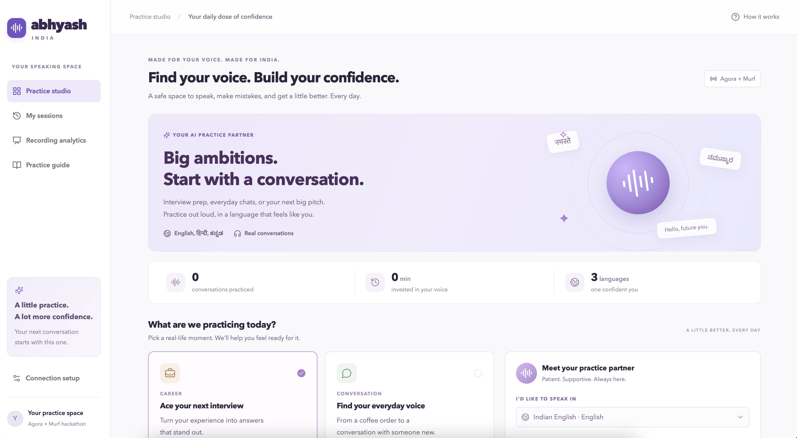
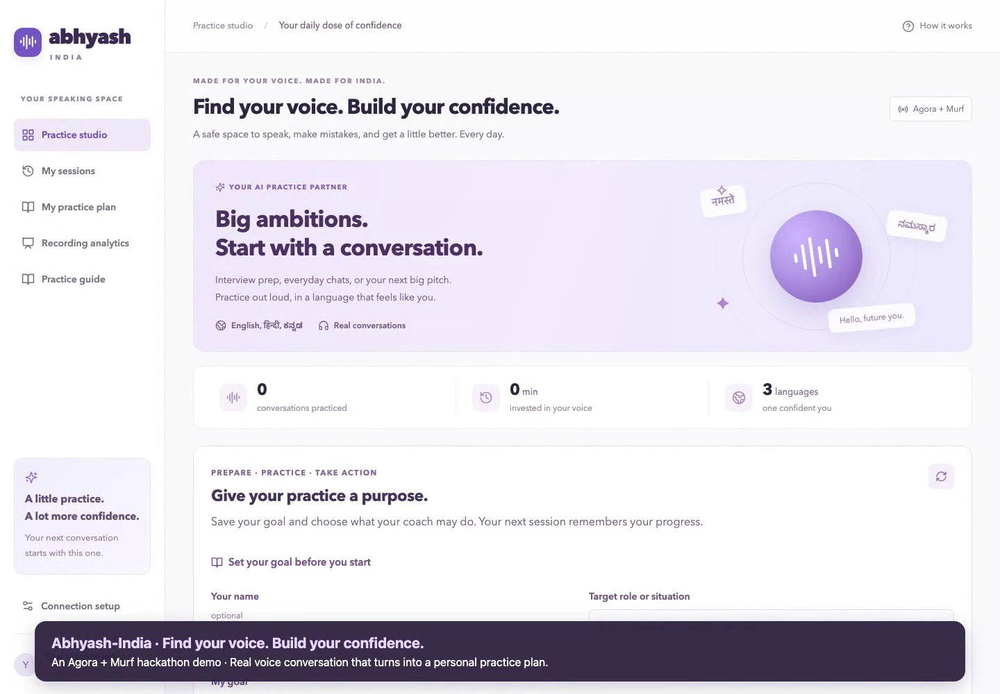
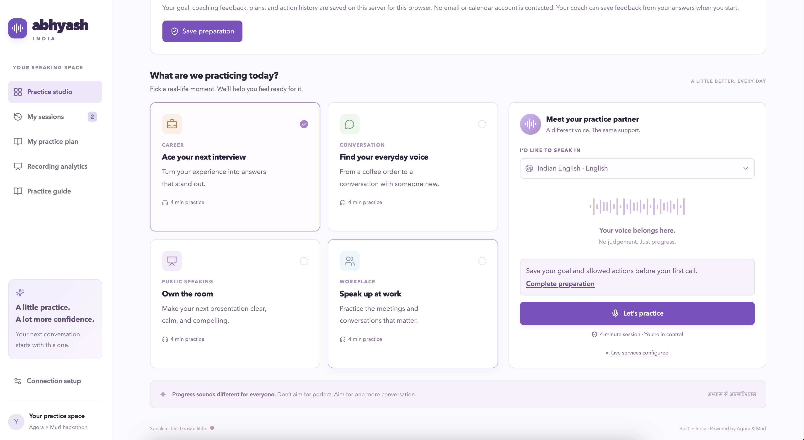
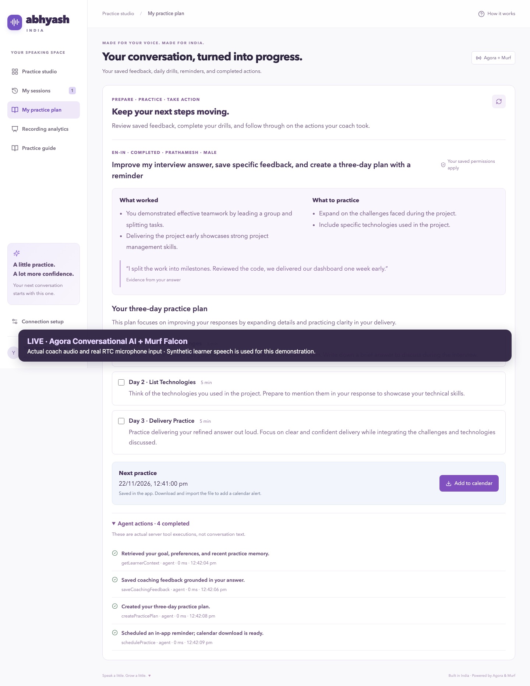

# Abhyash-India

### Find your voice. Build your confidence.

A multilingual speaking practice studio built for the **Agora + Murf hackathon**. Prepare for an interview, rehearse a presentation, or practice everyday and workplace conversations with a patient AI partner. Leave with specific feedback, a saved three-day practice plan, and an optional follow-up reminder.

**English · हिन्दी · ಕನ್ನಡ · తెలుగు · ଓଡ଼ିଆ**

[Watch the demo](docs/media/Abhyash-India-Demo.mp4) · [Quick start](#quick-start) · [Tech stack](#tech-stack) · [Hackathon walkthrough](docs/HACKATHON-DEMO.md)



## Demo

[](docs/media/Abhyash-India-Demo.mp4)

**[Watch or download the demo video — 81 seconds, MP4](docs/media/Abhyash-India-Demo.mp4)**

The recording shows a real Agora + Murf conversation using **synthetic learner speech**, followed by actual agent tool calls that save feedback, create a practice plan, and schedule a reminder. See the [verification report](artifacts/demo/live-verification.json) for the recorded run.

> The screenshots and video were captured on November 21, 2026, before Telugu and Odia were added. The current app supports five languages and a 300-minute reservation allowance. Live English audio and actions are verified; native-speaker testing remains pending for the other languages.

## What you can do

- **Practice real situations:** interviews, everyday conversations, presentations, and workplace communication.
- **Speak naturally:** real-time Agora audio with Murf Falcon voices and language-specific coaching.
- **Meet a named partner:** sessions alternate female and male voices, randomly choosing a compatible partner for the selected language.
- **Turn feedback into action:** save answer-specific coaching, three daily drills, and an optional reminder with a calendar download.
- **Keep your progress:** revisit saved plans and action history, export transcripts, and bring previous feedback into your next session.

## From conversation to action

1. **Prepare:** choose a scenario and language, share your goal, and authorize the actions your coach may take.
2. **Practice:** allow microphone access and speak with your AI partner for up to four minutes.
3. **Act:** ask the coach to save feedback and create a plan based on your answer.
4. **Follow through:** review your drills, download a calendar reminder, and mark completed practice tasks.



### Actual saved outcome



The agent has five HTTPS tools, invoked through Agora:

| Tool                   | Result                                                                            |
| ---------------------- | --------------------------------------------------------------------------------- |
| `getLearnerContext`    | Retrieves the learner's goal, permissions, and previous coaching context.         |
| `saveCoachingFeedback` | Saves specific strengths and improvements with a quote from the learner's answer. |
| `createPracticePlan`   | Creates three daily drills after feedback has been saved.                         |
| `schedulePractice`     | Saves an authorized in-app reminder and prepares an `.ics` calendar download.     |
| `requestCoachReview`   | Creates an internal review request when the learner has opted in.                 |

Actions use short-lived, per-session capability tokens, permission checks, and idempotent tool-call receipts. Calendar files are downloaded by the learner; the app does not send email or sync a calendar account. Review requests stay in the internal reviewer workspace.

## Quick start

**Requirements:** Node.js **20.19+**, npm, and configured Agora and Murf accounts. The live studio runs with Next.js alone; Python, Docker, and a separate database are optional.

```sh
npm install
cp apps/web/.env.example apps/web/.env.local
```

Fill in `apps/web/.env.local`. If that file already exists, edit it instead of replacing it.

| Variable                | What to provide                                      |
| ----------------------- | ---------------------------------------------------- |
| `AGORA_APP_ID`          | An Agora project with Conversational AI enabled.     |
| `AGORA_APP_CERTIFICATE` | That project's certificate for RTC token generation. |
| `AGORA_CUSTOMER_ID`     | Agora REST customer ID.                              |
| `AGORA_CUSTOMER_SECRET` | Agora REST customer secret.                          |
| `MURF_API_KEY`          | Murf API key.                                        |
| `ABHYASH_ACCESS_CODE`   | A private demo access code; required in production.  |

### Run locally with agent tools

```sh
npm run tools:install
npm run demo
```

Open **http://127.0.0.1:3100**. Keep the terminal open while practicing. The demo launcher starts the web app if needed and opens a temporary Cloudflare tunnel for the restricted agent-tool callback bridge.

For separate terminals, use `npm run dev` and `npm run tools:dev`. Only `/api/agent-tools` is exposed by the bridge; action requests require an expiring session capability. For a deployed callback endpoint, set `ABHYASH_TOOLS_BASE_URL` instead.

Save your preparation before selecting **Let's practice**. The connection panel reports configuration status; actual provider access is verified when a real session starts.

## Languages and practice partners

| Language             | Locale  | Female partners | Male partners              |
| -------------------- | ------- | --------------- | -------------------------- |
| Indian English       | `en-IN` | Pooja, Anisha   | Prathamesh, Samar, Abhinav |
| Hindi · हिन्दी       | `hi-IN` | Pooja, Anisha   | Prathamesh, Samar, Abhinav |
| Kannada · ಕನ್ನಡ      | `kn-IN` | Pooja           | Samar                      |
| Telugu · తెలుగు      | `te-IN` | Pooja, Anisha   | Prathamesh, Samar          |
| Odia / Oriya · ଓଡ଼ିଆ | `or-IN` | Anisha          | Samar                      |

The selected language configures recognition, the coach prompt, and voice output together. Partner names stay consistent across introductions, transcripts, session history, and exports. Voice compatibility follows the [Murf Falcon catalogue](https://murf.ai/api/docs/voices-styles/voice-library), with locale codes from [Agora's supported languages](https://docs.agora.io/en/realtime-media/speech-to-text/reference/supported-languages).

## Tech stack

### Live voice studio

| Layer                     | Technology                                                                                      |
| ------------------------- | ----------------------------------------------------------------------------------------------- |
| Frontend                  | Next.js 15, React 18, TypeScript, Tailwind CSS, and CSS Modules                                 |
| Shared UI state           | Zustand; the live practice page also uses React state                                           |
| Charts and icons          | Recharts and Lucide React                                                                       |
| Real-time audio           | Agora RTC Web SDK (`agora-rtc-sdk-ng`)                                                          |
| RTC authentication        | `agora-token`: certificate-authenticated, short-lived, channel-scoped tokens                    |
| Speech recognition        | Agora ARES, using native configuration                                                          |
| Conversation model        | Agora-managed OpenAI `gpt-4o-mini`; optional OpenAI-compatible provider                         |
| Voice output              | Murf AI Falcon `falcon-2.1`, streaming TTS                                                      |
| Agent lifecycle           | Agora v2 agent APIs for start, stop, recovery/status checks, and conversation history           |
| Server                    | Node.js with TypeScript Next.js route handlers in `apps/web`                                    |
| Agent workflows           | Five authenticated HTTPS tools, permission checks, dependency validation, and idempotency       |
| Callback connectivity     | Cloudflare Quick Tunnel through a restricted bridge for local demos                             |
| Voice-session history     | Browser `localStorage`, retaining the latest 30 completed conversations                         |
| Learner context and plans | Server-side `journeys.json`, scoped by a learner cookie                                         |
| Usage accounting          | Persistent server-side `usage.json`, atomic file locking, and a 300-minute reservation guard    |
| Local recording drafts    | IndexedDB through `idb`, used by the inherited recording flow                                   |
| Setup and demo scripts    | Node.js: `scripts/install-tools-bridge.mjs`, `scripts/tools-bridge.mjs`, and `scripts/demo.mjs` |

By default, the LLM uses Agora-managed access. To use your own OpenAI-compatible provider, configure `LLM_API_KEY`, `LLM_BASE_URL` (the full chat-completions endpoint), and `LLM_MODEL`. Provider secrets stay on the server.

### Optional recording and review backend

Inherited from Speech-Machine, this backend supports recorded sessions, delivery analytics, uploads, transcription, and local coaching. Live agent outcomes are saved in the journey store; they are not mirrored into the recording database.

| Layer                   | Technology                                                  |
| ----------------------- | ----------------------------------------------------------- |
| API                     | FastAPI, Uvicorn, and Pydantic                              |
| Worker                  | arq asynchronous jobs                                       |
| Database                | SQLAlchemy with PostgreSQL; SQLite for tests                |
| Queue and cache         | Redis                                                       |
| Media and transcription | FFmpeg and faster-whisper                                   |
| Shared code             | `packages/shared`: scoring utilities and types              |
| Recording UI            | MediaPipe, browser media APIs, and IndexedDB draft recovery |

### Infrastructure and developer tooling

| Area                   | Technology                                                                        |
| ---------------------- | --------------------------------------------------------------------------------- |
| Package management     | npm workspaces                                                                    |
| Containers             | Docker Compose: `docker-compose.yml` and `docker-compose.prod.yml`                |
| Unit testing           | Vitest                                                                            |
| Browser testing        | Playwright, including `verify:studio`, `verify:journey`, and opt-in `verify:live` |
| Formatting and linting | Prettier and ESLint                                                               |
| Type checking          | TypeScript                                                                        |
| Demo recording         | Playwright browser capture and FFmpeg MP4 export                                  |

## Usage allowance and persistence

The app enforces a **300-minute reservation allowance**. Each four-minute session reserves five minutes, including a connection and cleanup buffer. Existing usage is preserved across restarts; for example, 50 minutes reserved leaves 250 minutes available.

- Early stops and ambiguous startup failures keep their reservation. Definite HTTP 400/401/403/404/422 startup rejections release it.
- One active agent is allowed per shared ledger. An uncertain start or failed stop blocks new calls until recovery succeeds.
- The browser and server request shutdown at four minutes. RTC privileges expire after 260 seconds; the agent's idle timeout is 10 seconds after the subscribed user leaves.
- The default data directory is `apps/web/.abhyash/`, ignored by Git. Use `ABHYASH_DATA_DIR` for a persistent directory shared by workers on the same host.
- Reservation minutes are conservative application accounting, not the provider's billing statement. Agora account usage and separate Murf/RTC charges must be checked in their consoles.

<details>
<summary><strong>Recover an interrupted connection</strong></summary>

Open **Connection setup → Recover connection / stop active agent**. Recovery checks the unique server-generated channel, stops the matching agent, and preserves reserved usage.

If a crashed process left `usage.lock`, stop all Abhyash server processes, confirm that no agent remains active in Agora, and remove only the stale lock file. Restart and recover the connection. **Keep `usage.json`.** An ambiguous start with no returned agents may require waiting one minute before recovery can confirm the channel is empty.

</details>

## Development and verification

```sh
npm run typecheck
npm test
npm run build

# With the local web app running and Playwright installed:
npm run verify:studio
npm run verify:journey
```

Unit tests mock upstream providers. The studio and journey browser checks start no voice agents; the journey check uses explicitly labeled local fixtures. Live verification is an opt-in paid test documented in the [demo guide](docs/HACKATHON-DEMO.md#record-a-demo-video).

<details>
<summary><strong>Production setup</strong></summary>

```sh
npm run build
npm run start
```

Set `ABHYASH_ACCESS_CODE`, use a persistent Node host, and place an HTTPS reverse proxy in front for remote microphone access. Keep provider secrets and the App Certificate server-side; never prefix them with `NEXT_PUBLIC_`. The file-based locking design requires workers on one host with a shared persistent data directory.

</details>

<details>
<summary><strong>Run the optional recording backend</strong></summary>

```sh
cp .env.example .env
# Configure backend secrets and CORS.
npm run dev:stack
```

Docker Compose exposes web on **3100**, API on **8100**, PostgreSQL on **5433**, and Redis on **6380**, with separate named volumes. Avoid running a second web server on port 3100 at the same time.

| Route                         | Feature                                                         |
| ----------------------------- | --------------------------------------------------------------- |
| `/dashboard`                  | Practice analytics, goals, trends, uploads, and transcription   |
| `/record`                     | Camera/microphone recording, guided reading, and draft recovery |
| `/session/[id]`               | Transcript, delivery analysis, coaching, and exports            |
| `/setup`, `/login`, `/signup` | Backend account setup and authentication                        |

Backend authentication is separate from the live studio's private demo access code. The inherited [architecture](docs/ARCHITECTURE.md) and [local-machine guide](docs/local-machine.md) describe the original backend runtime and ports; use the Compose ports above for this project.

</details>

## Project structure

```text
apps/web/          Next.js studio, route handlers, and recording UI
apps/api/          Optional FastAPI backend and transcription worker
packages/shared/   Shared scoring and types
scripts/           Local launcher, tool bridge, verification, and recording
artifacts/         Screenshots and verification evidence
docs/media/       README screenshots and demo video
```

## References and credits

- [Hackathon coverage, demo steps, and verification limits](docs/HACKATHON-DEMO.md)
- [Agora agent lifecycle](https://docs.agora.io/en/ai/build/start-stop-agent)
- [Agora client/server architecture](https://docs.agora.io/en/ai/build/build-server-client)
- [Murf TTS configuration in Agora](https://docs.agora.io/en/ai/models/tts/murf)
- [ARES recognition](https://docs.agora.io/en/ai/models/asr/ares)
- [Conversation history](https://docs.agora.io/en/api-reference/api-ref/conversational-ai/history)

Built by **Susant Achary**. Rebuilt as a separate project from **Speech-Machine**; the original project is unchanged. The Apache-2.0 license and notices are preserved in [LICENSE](LICENSE).
